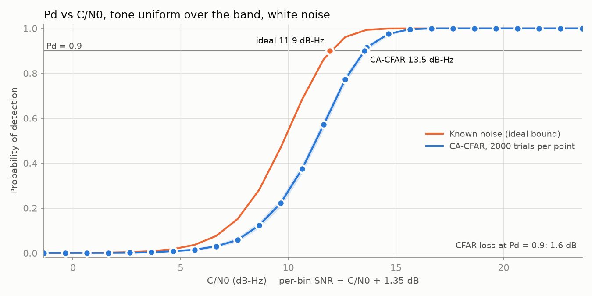

# Pd vs SNR results (milestone 3.2.3)

At the baseline settings, CA-CFAR detects a tone with Pd = 0.9 at **C/N0 = 13.5 dB-Hz**. A detector that knew the noise level exactly would need 11.9 dB-Hz, so the CFAR loss is 1.6 dB. Noise is white Gaussian only, so treat these as best-case numbers until real rod noise is in.



## Setup

| Setting | Value |
| --- | --- |
| Config | `configs/baseline.toml`, seed 1 |
| Band, sample rate, window | 10 to 1000 Hz, 4 kHz, 8192-point Hann (2.05 s, 0.49 Hz bins, 2028 bins in band) |
| False alarms | 1% per window, so 4.96e-6 per bin |
| CA-CFAR | 2 guard and 16 training bins per side; threshold multiplier 17.46 (24.85 near band edges) |
| Signal | One tone, frequency uniform over the band and phase uniform per trial, in white Gaussian noise |
| Sweep | Per-bin SNR 0 to 25 dB in 1 dB steps, 2000 trials per point |

Per-bin SNR is the SNR of a tone centred on a bin: SNR_bin = C/N0 + 10 log10(2.05 s) - 10 log10(1.5) = C/N0 + 1.35 dB. Tones between bins lose up to 1.42 dB more, which the trials include because f0 is random.

A trial counts as a detection when the detector reports a peak within one bin (0.49 Hz) of the true tone frequency. Each trial uses the same noise, frequency and phase at every SNR, so the curve is smooth and the points differ only in tone amplitude.

## Results

| C/N0 (dB-Hz) | Per-bin SNR (dB) | Pd, CA-CFAR | 95% interval | Pd, known noise |
| --- | --- | --- | --- | --- |
| 8.6 | 10 | 0.124 | [0.110, 0.139] | 0.281 |
| 11.6 | 13 | 0.572 | [0.550, 0.594] | 0.863 |
| 12.6 | 14 | 0.774 | [0.755, 0.791] | 0.962 |
| 13.6 | 15 | 0.915 | [0.902, 0.926] | 0.994 |
| 14.6 | 16 | 0.976 | [0.968, 0.981] | 1.000 |
| 15.6 | 17 | 0.997 | [0.993, 0.998] | 1.000 |

| At Pd = 0.9 | C/N0 | Per-bin SNR |
| --- | --- | --- |
| CA-CFAR | 13.5 dB-Hz | 14.9 dB |
| Known noise (ideal bound) | 11.9 dB-Hz | 13.3 dB |
| CFAR loss | 1.6 dB | |

The CA-CFAR value comes from interpolating between grid points. With 2000 trials it is good to about ±0.1 dB.

The known-noise bound is the Marcum Q1 detection probability for one bin, averaged over tone offsets from the bin centre. A Monte Carlo test (`IdealBound.MatchesKnownNoiseMonteCarlo`) checks that the simulated tone and noise scaling agrees with it. CA-CFAR counts a detection in either of the two bins nearest the tone, but the bound only tests the nearest bin. That gives CA-CFAR a slight edge, so the true loss may be a little larger than 1.6 dB.

Most of the loss comes from the threshold. With 32 correlated training bins, the CA threshold averages 17.46 times the noise estimate. A detector that knew the noise would use -ln(4.96e-6) = 12.2 times the true noise level, 1.55 dB lower.

False alarms are 24 of 2000 windows (1.2%) at every SNR, inside the 95% interval [0.8%, 1.8%] for the 1% design. The count is the same at every SNR because every SNR uses the same noise.

## What it means for the sensor

C/N0 is the tone power over the noise power spectral density at the sensor. For a received tone of rms field B_rms, the sensor's noise floor (one-sided, per root hertz) must satisfy

```
noise floor <= B_rms / 10^(C/N0 / 20) = B_rms / 4.75     at C/N0 = 13.5 dB-Hz
```

For example, a 1 pT rms tone at the rod needs a combined rod, amplifier and AD3 noise floor of at most 0.21 pT/√Hz in the search band, for one 2.05 s window. The same formula applies in volts at the AD3 input once the HFR-1 antenna factor is known.

## Limits

- White Gaussian noise only. 60 Hz harmonics, 1/f noise and impulses will raise the required C/N0, and CA-CFAR is the variant most hurt by interferers in its training cells.
- One window length (2.05 s). Longer windows raise SNR_bin by 10 log10(T) for a given C/N0, but they also add bins to search. The planned window sweep will measure the net effect.
- Steady tone only. Drift within a window is not included.

## Reproduce

```
./build/pd_sweep configs/baseline.toml      # results/pd_vs_snr.csv and pd_vs_snr_summary.csv
python3 scripts/plot.py results/pd_vs_snr.csv
```
